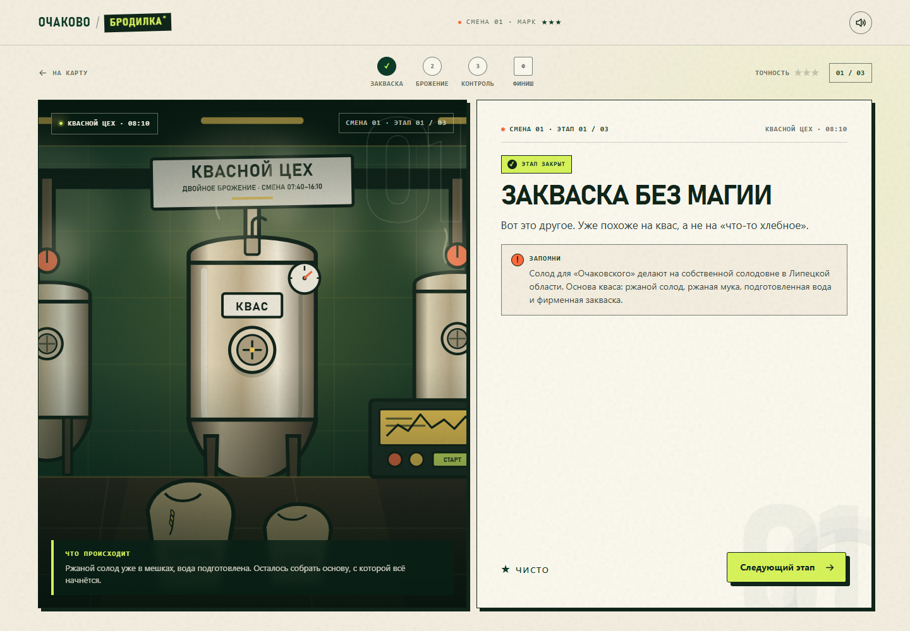

# БРОДИЛКА — Очаково

Мобильное веб-приложение (PWA) с интерактивным квестом о первой смене на заводе «Очаково». Не Telegram-бот: самостоятельная игра, которую можно открыть в браузере, установить на домашний экран телефона и частично проходить офлайн.

## Важно про продукт

По официальному сайту `ochakovo.ru` у компании есть и пивное направление, и широкая линейка кваса, лимонадов, воды и других напитков. В этой игре по брифу **пиво, пивовары, хмель и алкогольные вакансии не используются вообще**. Весь квест — про квас «Очаковский» двойного брожения, лимонады и воду. Алкогольных маркеров, возрастных бейджей и формулировок «0%» в интерфейсе нет.

Факты сверены с официальными материалами:

- [О компании «Очаково»](https://ochakovo.ru/)
- [Как делают настоящий квас](https://ochakovo.ru/kak-delayut-nastoyashhij-kvas/)
- [Как проходит двойное брожение](https://ochakovo.ru/kak-proxodit-dvojnoe-brozhenie/)
- [Карьера и условия](https://ochakovo.ru/rabota/)

## Что внутри

- **Лендинг** с квасом, лимонадом, правилами и призом.
- **Короткое интро-диалог** с Пузырём и Шефом: реплики меняются без перезагрузки, слева — текущий говорящий.
- **Три героя и три маршрута:**
  - Марк — квасовар: закваска, двойное брожение, контроль партии.
  - Даша — оператор линии розлива: бракераж, остановка линии, FIFO на складе.
  - Лев — лаборант контроля качества: кислотность, пробы, вердикт.
- **Мини-игры:** выбор компонентов, сортировка этапов, поиск брака на время, pH-ползунок, поиск отклонения в пробах, рабочие решения.
- **Диалог как переписка:** герой слева, Пузырь справа, история сообщений сохраняется.
- **Приз:** уникальный промокод на 150 баллов на продукцию + звёзды за точность. Код генерируется заново на каждое завершение и не попадает в шаринг.
- **Финал:** отклик на вакансию, история другого героя или шеринг общей промо-картинкой.
- **Форма отклика:** имя, телефон, email, город и необязательная ссылка на резюме. Файл прикреплять не нужно.
- **PDF-заявка:** на экране «Резюме у HR» кнопка скачивает готовый PDF со всеми данными.
- **PWA:** manifest, service worker, установка на домашний экран, офлайн-оболочка, safe-area, standalone-режим.
- **Сохранение прогресса** в `localStorage` и системная кнопка «Назад» без вылета из игры.
- **Звук** на Web Audio API, отключается кнопкой в шапке.
- **Адаптив:** проверены desktop 1440×1000, mobile 390×844 и 360×740, landscape.

## Превью





## Как открыть

### Вариант 1. Быстро, без сервера

Откройте `index.html` двойным кликом. Игра работает, но PWA-установка и service worker на `file://` недоступны — это ограничение браузеров.

### Вариант 2. Как PWA (рекомендуется)

Нужен Node.js 18+:

```powershell
cd ochakovo-brodilka
node serve.js
```

Откройте `http://127.0.0.1:4173/`. На телефоне в той же сети откройте адрес компьютера (например, `http://192.168.1.10:4173/`) или задеплойте папку на HTTPS-хостинг. Для установки PWA нужен `http://localhost` или HTTPS.

## PWA

- `manifest.webmanifest` — standalone, portrait-primary, тема, иконки 192/512, maskable 512.
- `sw.js` — precache оболочки, network-first для HTML/CSS/JS, offline-фолбэк на `index.html`.
- Иконки: `assets/icon-192.png`, `assets/icon-512.png`, `assets/icon-maskable-512.png`, `assets/apple-touch-icon.png`.
- Кнопка «Установить» появляется, когда браузер присылает `beforeinstallprompt`.
- iOS: установка через Safari → «Поделиться» → «На экран „Домой“»; автоматического промпта там нет.
- При изменении ассетов или кода меняйте `VERSION` в `sw.js`, иначе старый кэш может отдать предыдущую версию.

## Структура

```text
ochakovo-brodilka/
├── index.html
├── manifest.webmanifest
├── sw.js
├── serve.js
├── css/
│   ├── styles.css
│   └── game.css
├── js/
│   ├── config.js
│   ├── data.js
│   ├── pdf.js
│   └── app.js
├── assets/          # SVG-иллюстрации, портреты, сцены, иконки PWA
├── preview/         # скриншоты
├── docs/            # product/UX-спека
└── qa-report/       # тест-план и отчёт QA
```

## Как менять контент

- Сценарий, реплики, задания, факты и вакансии — `js/data.js`.
- Цвета и типографика — CSS-переменные в начале `css/styles.css`.
- Портреты и сцены — SVG в `assets/`.
- Логика экранов, мини-игр и PWA — `js/app.js`, `sw.js`.

## Подключение HR

По умолчанию форма работает в демо-режиме. Чтобы отправлять заявки в реальную HR-систему, укажите endpoint в `js/config.js`:

```js
window.BRODILKA_CONFIG = {
  applyEndpoint: "https://hr.example.com/api/ochakovo/apply"
};
```

Форма отправит `multipart/form-data`: `name`, `phone`, `email`, `city`, `resumeLink`, `consent`, `vacancy`, `charId`, `source`. Файл резюме не передаётся: в форме осталась только необязательная ссылка.

Если endpoint не задан, заявка сохраняется в `localStorage`; если запрос не удался — форма покажет ошибку и позволит повторить.

## Ограничения демо

- Вакансии, зарплатные условия, приз и промокоды — демонстрационные, не публичная оферта.
- Реальный HR-вебхук, учёт баллов и промокодов нужно подключать отдельно.
- На iOS нет `beforeinstallprompt`: установка вручную через Safari.
- Нативное поведение standalone-окна и установку стоит перепроверить на реальных iPhone/Android перед публикацией.
- Юридические формулировки, состав и пользу продуктов нужно согласовать с Очаково.
- PDF-заявка собрана как A4-страница с изображением: визуально всё читается, но текст не выделяется. Для цифрового PDF с текстовым слоем нужна отдельная генерация на сервере.

## Проверка

Сквозные сценарии проверены через headless Edge + CDP на финальной сборке (SW v9). Полный регресс: 22 сценария, 595 проверок — 589 pass, 0 fail, 5 warn (все три P2 затем исправлены), 0 fatal. Постфикс v8: 8 сценариев, 367 проверок — 0 fail, 0 warn, 0 fatal. Финальный бейдж v9: `final-fixes` — 47/47 pass. **Verdict PASS.** Покрыты все три маршрута, мини-игры, чат-диалог, форма без файла, PDF, шаринг, история, PWA manifest, service worker, offline reload и мобильные viewport. Подробности — в [qa-report/final-v2.md](qa-report/final-v2.md).
