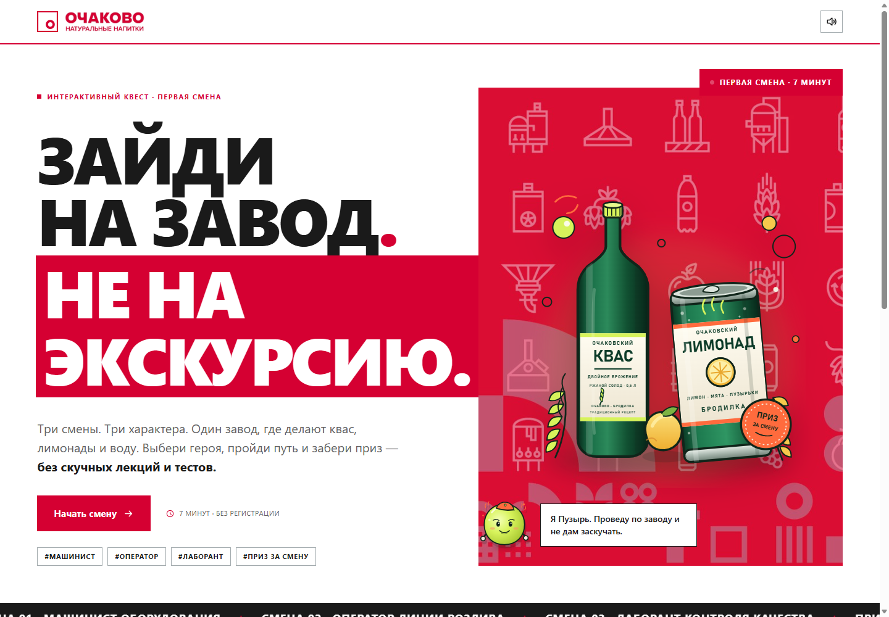
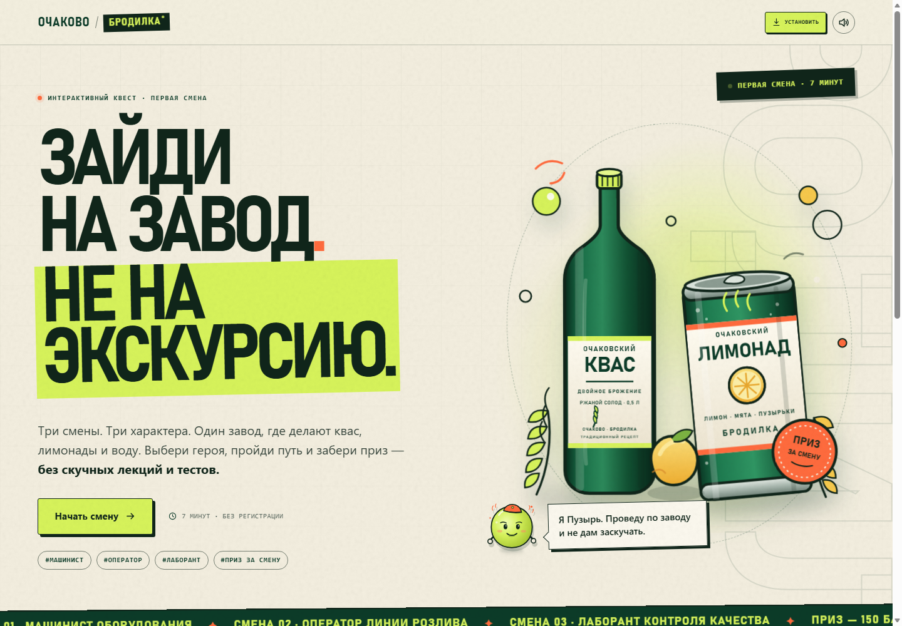
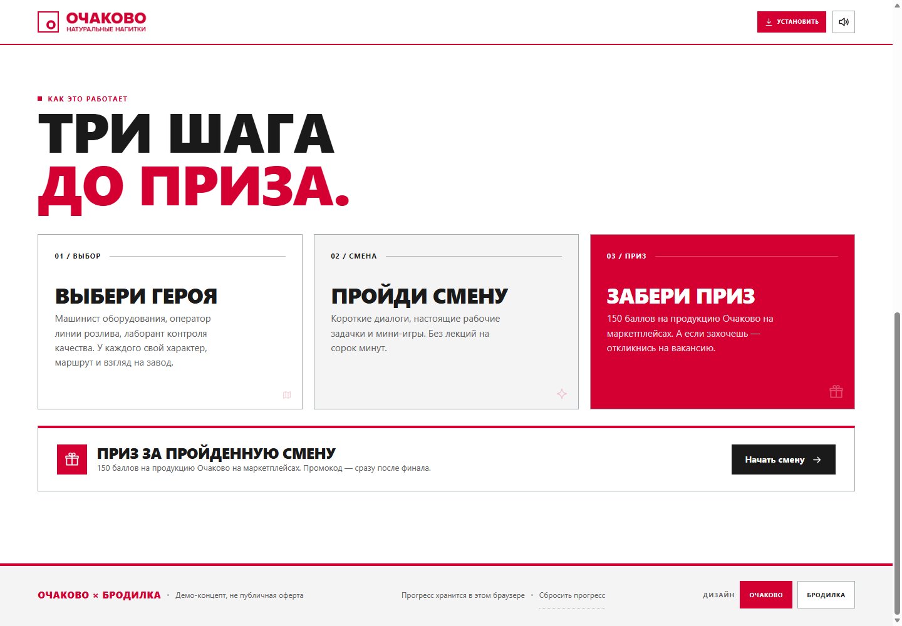
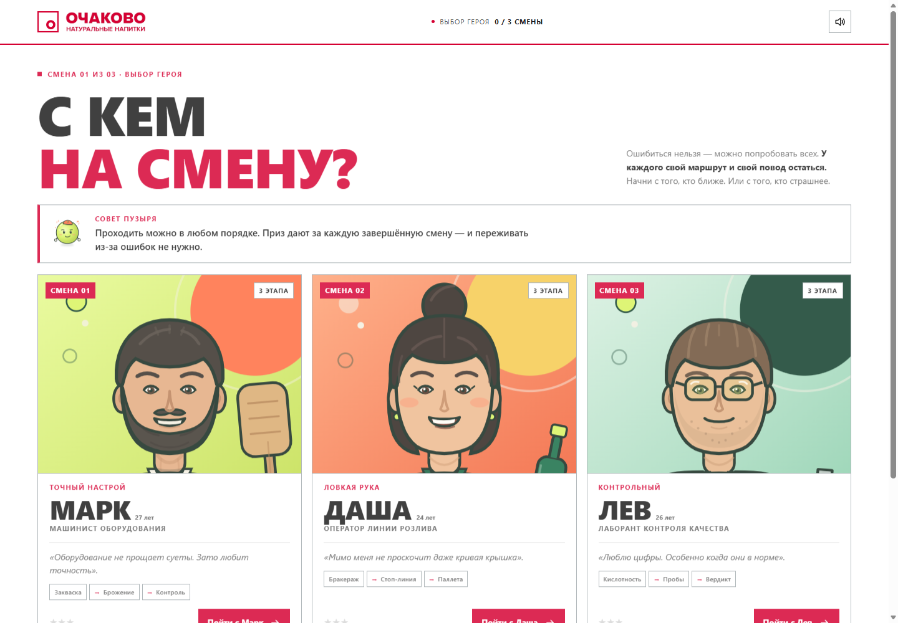
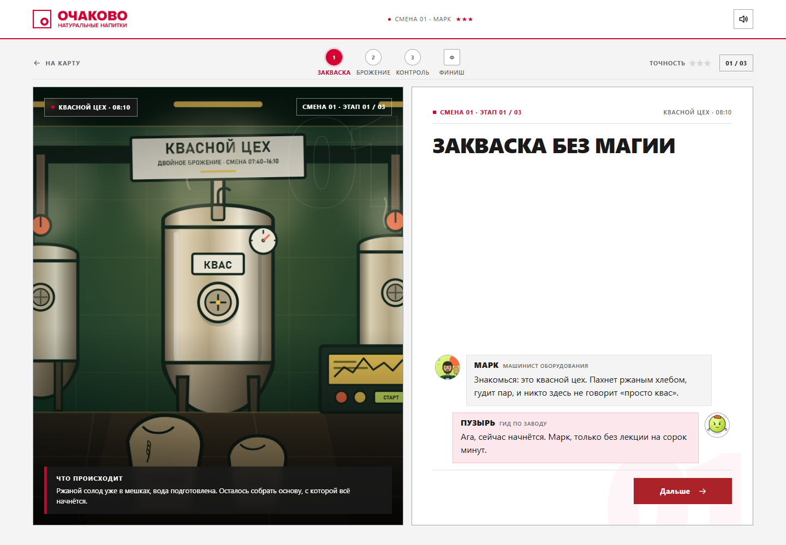
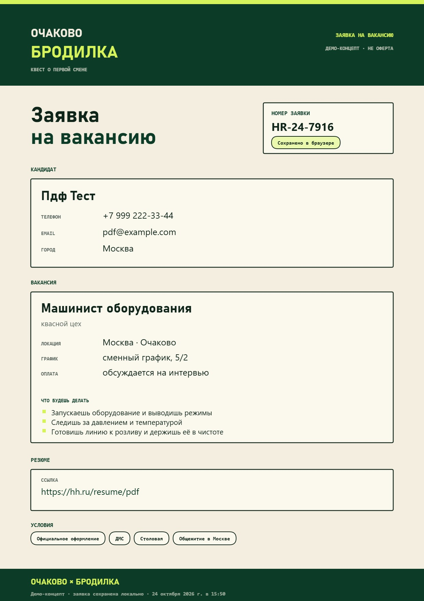

# БРОДИЛКА

Квест о первой смене на заводе «Очаково»: квас «Очаковский» двойного брожения, лимонады и вода. Работает в браузере, ставится на домашний экран телефона, часть экранов открывается офлайн.

Три героя, у каждого свой маршрут из трёх этапов. Внутри мини-игры, диалог с гидом Пузырём, промокод на 150 баллов в финале и форма отклика на вакансию. Ванильный JS, без сборки и бэкенда.

Это демо-концепт, а не официальный продукт «Очаково». Что именно демо, написано в конце.

По умолчанию открывается брендовый дизайн по брендбуку «Очаково». В футере есть переключатель на наш первоначальный дизайн «БРОДИЛКА» — выбор запоминается.





Переключатель внизу страницы:



## Как играть

Сначала короткое интро с Шефом и Пузырём. Потом выбираешь героя, у каждого своя смена:



- Марк, машинист оборудования: запуск и режимы, давление и температура, подготовка линии к розливу.
- Даша, оператор линии розлива: бракераж, остановка линии, паллеты по FIFO.
- Лев, лаборант контроля качества: кислотность, пробы, вердикт.

Дальше три этапа с заданиями и финал. Время сцены идёт от 07:40 к 16:10, как настоящая смена.

Задания разные. Нужно собрать четыре компонента кваса из семи, расставить этапы производства по порядку, найти брак на линии, пока идёт таймер, выставить кислотность ползунком в диапазон 3,8–4,2, вычислить пробу с отклонением и решить, что делать с браком.

Диалог устроен как переписка: герой слева, Пузырь справа, история не пропадает. Прогресс живёт в localStorage, кнопка «Назад» работает без вылета из игры.

### Маскот

Пузырь — лаймовый пузырь в оранжевой кепке, гид по заводу. Отдельные файлы: [герой](assets/mascot/mascot-hero.png), [character sheet](assets/mascot/mascot-sheet.png), [аватар](assets/mascot/mascot-face.png). Подробное описание — [docs/mascot.md](docs/mascot.md).



## Финал

Смена закрывается экраном с промокодом на 150 баллов и звёздами за точность. Код генерируется через `crypto.getRandomValues` на каждое прохождение — новый, и в шаринг не попадает.

Дальше три пути: откликнуться на вакансию, пройти маршрут другого героя, отправить промо-картинку. Картинка уходит через Web Share API, а если браузер не умеет, она просто скачается.

## Заявка и PDF

Форма просит имя, телефон, email, город и ссылку на резюме (необязательно). Файл прикреплять не нужно.

На экране «Заявка у HR» кнопка скачивает PDF с данными заявки. PDF рисуется на canvas как A4-страница с картинкой, кириллица читается. Текстового слоя нет, об этом ниже.



## Запуск

Нужен Node.js 18 или новее.

```bash
node serve.js
```

Сервер поднимет `http://127.0.0.1:4173/`. PWA, service worker и офлайн работают только на localhost или HTTPS: это правило браузеров, а не настройка проекта.

`index.html` можно открыть и двойным кликом, но тогда установка на домашний экран и офлайн не заработают.

## Стек

HTML, CSS и JS без фреймворков и сборки. Зависимостей нет.

Дизайн собран на CSS-переменных: брендовая тема по брендбуку «Очаково» и наш вариант «БРОДИЛКА»; переключатель меняет только `data-design`, без перерисовки игры.

Для установки и офлайн-оболочки отвечают service worker и manifest. Звук собран на Web Audio и отключается кнопкой в шапке. PDF рисуется на canvas, шаринг идёт через Web Share API, прогресс и заявки лежат в localStorage. Node нужен только для локального сервера и QA-прогона.

## Структура

```text
ochakovo-brodilka/
├── index.html
├── manifest.webmanifest
├── sw.js
├── serve.js
├── css/
│   ├── styles.css
│   ├── game.css
│   └── brand.css
├── js/
│   ├── app.js
│   ├── data.js
│   ├── pdf.js
│   └── config.js
├── assets/          # SVG-сцены, портреты, иконки PWA
│   ├── brand/       # логотип, знак и паттерны Очаково
│   └── mascot/      # подробный пакет Пузыря
├── preview/         # скриншоты
├── docs/            # product/UX-спека и описание маскота
└── qa-report/       # тест-план, отчёт, QA-раннер
```

Контент: реплики, задания, факты и вакансии лежат в `js/data.js`. Цвета и шрифты в CSS-переменных `css/styles.css`.

## Проверки

Сквозные сценарии гоняются через headless Edge и DevTools Protocol: 23 сценария, полный прогон — 679 проверок, 0 fail, 2 warn (P2 исправлен); постфикс v11 — 176 проверок, 0 fail, 0 warn. Покрыты оба дизайна, переключатель, мобильные экраны, PWA, PDF и роль машиниста. Вердикт: PASS.

Запуск: `node qa-report/run-qa.js`, нужен Node 22+ и установленный Edge или Chrome. Подробности в [qa-report/final-v3.md](qa-report/final-v3.md), план в [qa-report/test-plan.md](qa-report/test-plan.md).

## Ограничения

- Это демо: вакансии, зарплаты, приз и промокоды выдуманы, публичной офертой они не считаются.
- Бренд «Очаково» принадлежит компании. Юридические формулировки и контент нужно согласовать с ней.
- HR-вебхук не подключён. Заявка остаётся в localStorage браузера со статусом «в очереди у HR». Endpoint задаётся в `js/config.js`.
- Прогресс и заявки хранятся в localStorage без шифрования.
- PDF это страница-картинка: текст не выделяется и не индексируется.
- На iOS установка вручную через Safari: «Поделиться» → «На экран Домой». Автоматического промпта там нет.
- Установку, системный back-gesture и скринридеры на реальных телефонах QA не проверяет: headless их не воспроизводит.

## Ссылки

- Репозиторий: https://github.com/HaCkER323/ochakovo-brodilka
- О компании: https://ochakovo.ru/
- Как делают квас: https://ochakovo.ru/kak-delayut-nastoyashhij-kvas/
- Двойное брожение: https://ochakovo.ru/kak-proxodit-dvojnoe-brozhenie/
- Карьера: https://ochakovo.ru/rabota/

Факты о квасе, брожении и условиях взяты с официального сайта.
