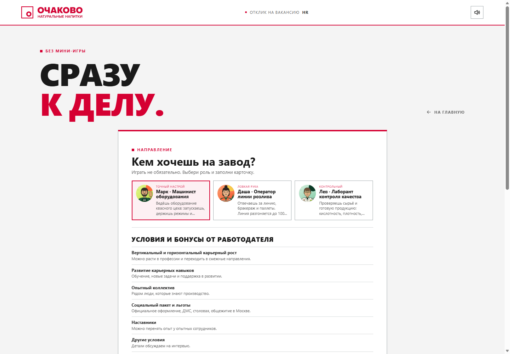
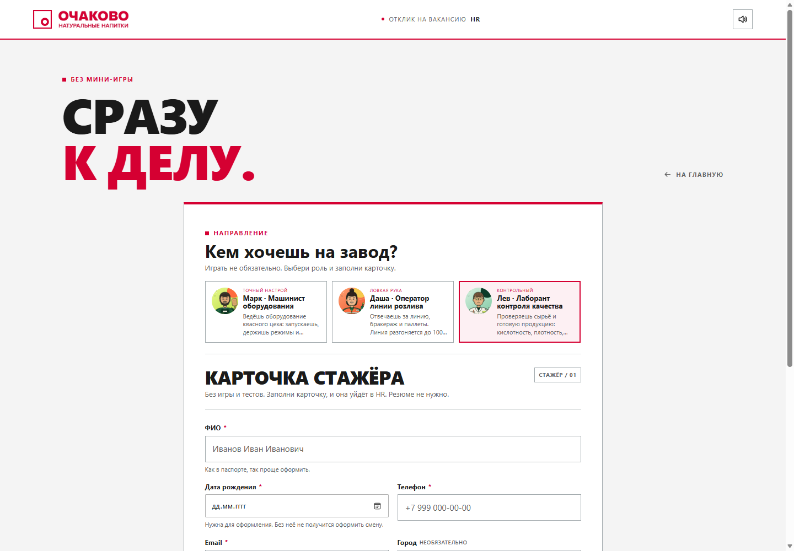
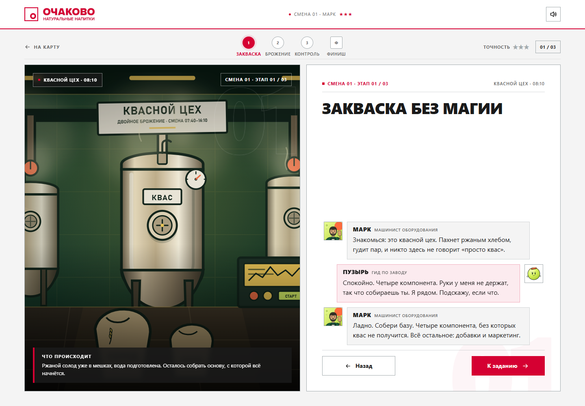
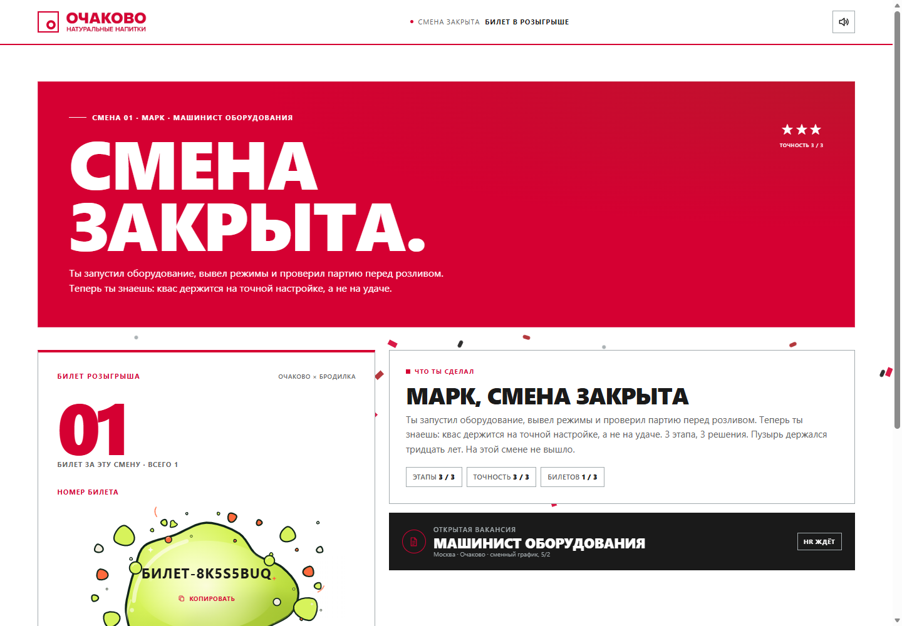

# БРОДИЛКА

Квест о первой смене на заводе «Очаково». Внутри квас «Очаковский» двойного брожения, лимонады и вода. Игра работает в браузере, ставится на домашний экран телефона, часть экранов открывается офлайн. Рассчитана на 18–24: без снисходительного тона и «детского» маскота.

Три героя, у каждого свой маршрут из трёх этапов. Внутри мини-игры, диалог с гидом Пузырём, билет в розыгрыш в финале и форма отклика на вакансию. Фронтенд без сборки, для откликов есть маленький Node-сервер.

Это демо-концепт, а не официальный продукт «Очаково». Что именно демо, написано в конце.

По умолчанию открывается брендовый дизайн по брендбуку «Очаково». В футере переключатель на наш первоначальный дизайн «БРОДИЛКА»; выбор запоминается.


Переключатель внизу страницы:


## Как играть

Сначала короткое интро с Шефом и Пузырём. Потом выбираешь героя, у каждого своя смена:

Если проходить квест не хочется, на главной есть кнопка «Перейти к вакансиям»: выбираешь персонажа, смотришь, чем он занимается, и сразу отправляешь карточку в HR.

В обычном и быстром отклике теперь один и тот же блок «Условия и бонусы от работодателя»: карьерный рост, развитие навыков, опытный коллектив, соцпакет, наставники и другие условия.






- Марк, машинист оборудования: запуск и режимы, давление и температура, подготовка линии к розливу.
- Даша, оператор линии розлива: бракераж, остановка линии, паллеты по FIFO.
- Лев, лаборант контроля качества: кислотность, пробы, вердикт.

Дальше три этапа с заданиями и финал. Время сцены идёт от 07:40 к 16:10, как настоящая смена.

Задания разные. Нужно собрать четыре компонента кваса из семи, расставить этапы производства по порядку, найти брак на линии, пока идёт таймер, выставить кислотность ползунком в диапазон 3,8–4,2, вычислить пробу с отклонением и решить, что делать с браком.

Диалог устроен как переписка: герой слева, Пузырь справа, история не пропадает. В диалоге есть «Назад», а из задания можно вернуться к последней реплике. Прогресс живёт в localStorage, кнопка «Назад» работает без вылета из игры.



### Маскот

Пузырь выглядит как лаймовый пузырь в оранжевой кронен-крышке. Это дух завода и гид. Он родился в первой партии кваса «Очаковский» в 1996 году и с тех пор не лопался. По вайбу шут-проводник для 18–24: 50% шут, 30% проводник, 20% заботливый друг. СДВГ-паникёр, но без истерики в каждой строке. Смену проходит игрок: Пузырь показывает, объясняет и поддерживает. Руками он ничего не делает, они у него не держат вес. Отдельные файлы: [герой](assets/mascot/mascot-hero.png), [character sheet](assets/mascot/mascot-sheet.png), [аватар](assets/mascot/mascot-face.png). Подробное описание в [docs/mascot.md](docs/mascot.md).


## Финал

Смена закрывается экраном с номером билета и звёздами за точность. Пузырь не выдерживает, лопается, а номер билета лежит на его кляксе. Один квест — один билет. Билеты привязываются к номеру телефона: вход по телефону и код подтверждения пока работают в демо-режиме. Номер и билеты хранятся в localStorage, ссылка «Мои билеты» появляется в футере.

Дальше три пути: откликнуться на вакансию, пройти маршрут другого героя, отправить промо-картинку. Картинка уходит через Web Share API, а если браузер не умеет, она просто скачается.



## Заявка и PDF

Форма «Карточка стажёра» просит ФИО, дату рождения, телефон, email, город, ВУЗ или колледж и ссылку на резюме. Резюме и образование можно не заполнять: файл прикреплять не нужно.

Карточки уходят на `/api/applications` и складываются в `data/applications.json`. Админка живёт на `/admin`: ссылки в интерфейсе нет, вход по паролю. Пароль задаётся через `ADMIN_PASSWORD` или создаётся в `.admin-password` при первом запуске.

В админке только количество откликов, предпоказ последних шести и кнопка «Выгрузить все в Excel». После скачивания выгруженные отклики удаляются с сайта. Никаких фильтров, редактирования или отдельных удалений нет.

На экране «Карточка у HR» кнопка скачивает PDF с данными заявки. PDF рисуется на canvas как A4-страница с картинкой, кириллица читается. Текстового слоя нет, об этом ниже.


## Как запустить

Для демо нужен Node.js 18 или новее и один запущенный процесс.

```bash
node serve.js
```

Сервер поднимет `http://127.0.0.1:4173/`. Там же `/admin`. Если `ADMIN_PASSWORD` не задан, пароль появится в консоли и сохранится в `.admin-password`.

`index.html` можно открыть двойным кликом, но тогда не будет ни отправки карточек, ни админки: им нужен сервер.

## Куда хостить

Для игры хватит статического хостинга с HTTPS. Для сбора откликов и админки нужен Node-процесс с постоянным диском: Railway, Render, VPS или похожий хостинг. Подробности и варианты внешней отправки в [docs/hosting.md](docs/hosting.md).

### Деплой на Render

В репозитории есть `render.yaml` с бесплатным web-сервисом: Node, регион Frankfurt, `HOST=0.0.0.0`, генерируемый `SESSION_SECRET` и пароль `ADMIN_PASSWORD`, который Render спросит при создании.

1. Открой [Deploy to Render](https://render.com/deploy?repo=https://github.com/HaCkER323/ochakovo-brodilka).
2. Подключи GitHub и выбери репозиторий `HaCkER323/ochakovo-brodilka`, ветку `main`.
3. Render прочитает `render.yaml` и попросит `ADMIN_PASSWORD`.
4. Дождись деплоя и проверь `/` и `/admin`.

На Free у Render нет постоянного диска: `data/applications.json` живёт в контейнере и может исчезнуть при рестарте или засыпании сервиса. Для реального сбора откликов переключи план на Starter и добавь диск:

```yaml
plan: starter
disk:
  name: brodilka-data
  mountPath: /opt/render/project/src/data
  sizeGB: 1
```

Если Blueprint не используется, создай Web Service вручную: runtime Node, build `npm install --omit=dev`, start `node serve.js`, задай `HOST=0.0.0.0` и `ADMIN_PASSWORD`.

## Из чего собрано

HTML, CSS и JS без фреймворков и сборки. Зависимостей нет.

Для карточек и админки есть `serve.js` и папка `server/`: HTTP-сервер, JSON-хранилище, подписанная cookie и XLSX без внешних библиотек. Node нужен только для сервера и QA-прогона.

Дизайн собран на CSS-переменных: брендовая тема по брендбуку «Очаково» и наш вариант «БРОДИЛКА»; переключатель меняет только `data-design`, без перерисовки игры.

Для установки и офлайн-оболочки отвечают service worker и manifest. Звук собран на Web Audio и отключается кнопкой в шапке. PDF рисуется на canvas, шаринг идёт через Web Share API, прогресс и заявки лежат в localStorage. Node нужен только для локального сервера и QA-прогона.

## Что где лежит

```text
ochakovo-brodilka/
├── index.html
├── admin.html       # скрытая админка откликов
├── admin.css
├── admin.js
├── manifest.webmanifest
├── sw.js
├── serve.js
├── package.json
├── render.yaml
├── server/          # HTTP API, хранилище, auth и XLSX
├── data/            # отклики, создаётся сервером, в git не попадает
├── css/
│   ├── styles.css
│   ├── game.css
│   └── brand.css
├── js/
│   ├── app.js
│   ├── data.js
│   ├── pdf.js
│   └── config.js
├── assets/          # SVG-сцены, портреты, иконки PWA
│   ├── brand/       # логотип и знак Очаково
│   └── mascot/      # подробный пакет Пузыря
├── preview/         # скриншоты
├── docs/            # хостинг, заявки и описание маскота
└── qa-report/       # тест-план, отчёт, QA-раннер
```

Контент: реплики, задания, факты и вакансии лежат в `js/data.js`. Цвета и шрифты в CSS-переменных `css/styles.css`.

## Что проверяли

Сквозные сценарии гоняются через headless Edge и DevTools Protocol. Полный прогон v24: 28 сценариев, 870 проверок, 865 pass, 2 fail (P2 закрыт в v25), 2 warn, 1 skip. Целевой прогон v25: 108 проверок, 107 pass, 0 fail. API 38/38, админка 16/16, XLSX 9/9. Покрыты оба дизайна, Пузырь, форма, быстрый отклик, билеты, телефон, PDF, назад в диалогах, splat, админка, Excel, PWA и мобильные экраны. Вердикт: PASS.

Запуск: `node qa-report/run-qa.js`, нужен Node 22+ и установленный Edge или Chrome. Подробности в [qa-report/final-v9.md](qa-report/final-v9.md), план в [qa-report/test-plan.md](qa-report/test-plan.md).

## Что не готово

- Это демо: вакансии, зарплаты, билеты и розыгрыш выдуманы, публичной офертой они не считаются.
- Бренд «Очаково» принадлежит компании. Юридические формулировки и контент нужно согласовать с ней.
- HR-интеграция сделана как файл на сервере, а не как внешняя CRM. Для нагрузки и нескольких инстансов нужна нормальная БД.
- Отклики и пароль админки не попадают в git: `data/` и `.admin-password` закрыты `.gitignore`.
- Прогресс игры хранится в localStorage без шифрования. Данные откликов на сервере тоже без шифрования.
- PDF это страница-картинка, текст не выделяется и не индексируется.
- На iOS установка вручную через Safari: «Поделиться» → «На экран Домой». Автоматического промпта там нет.
- Установку, системный back-gesture и скринридеры на реальных телефонах QA не проверяет: headless их не воспроизводит.

## Печать

Листовка A5, две стороны: [ochakovo-brodilka-flyer-a5.pdf](print/ochakovo-brodilka-flyer-a5.pdf). Внутри QR на `https://ochakovo-brodilka.onrender.com/`, преимущества работы и три направления. Исходник вёрстки и QR лежат в `print/`.

## Ссылки

- Репозиторий: https://github.com/HaCkER323/ochakovo-brodilka
- О компании: https://ochakovo.ru/
- Как делают квас: https://ochakovo.ru/kak-delayut-nastoyashhij-kvas/
- Двойное брожение: https://ochakovo.ru/kak-proxodit-dvojnoe-brozhenie/
- Карьера: https://ochakovo.ru/rabota/

Факты о квасе, брожении и условиях взяты с официального сайта.
